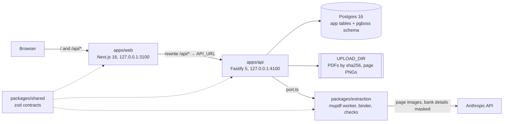

# Architecture

DCT Finance turns signed sponsor contracts into an approved **invoicing master** (the rulebook): every fee, cap, due day and budget-grid cell, each with its page reference. The design rule is **no silent errors**: a value is unconfirmed until the PDF's own text or a person confirms it, and nothing unconfirmed can be approved. The decision behind this is [ADR-001](phase-1/adr-001-extraction-evidence.md).

## Components

| Part | What it does |
|---|---|
| `apps/web` | The only UI. Client components fetch through `src/lib/api.ts` (TanStack Query). In sample mode (`NEXT_PUBLIC_API_MOCK=1`) `src/lib/mock/server.ts` answers every request in the browser instead of the API. |
| `apps/api` | HTTP API under `/api/v1`, probes `/livez` and `/readyz`, and the job workers (pg-boss) in the same process. All state is in Postgres; files are in `UPLOAD_DIR`. |
| `packages/extraction` | Everything that touches a PDF or a model: page count, rendering and text layer (mupdf, in a worker thread), the AI reads, the evidence binder, the contract checks, scoring. The API reaches it only through `apps/api/src/extraction/port.ts`. |
| `packages/shared` | The zod schemas and types every other package uses (rulebook, evidence, review questions, API bodies and DTOs), plus pure helpers that must behave the same on the server and in the browser. |

There is no login. Both servers listen on 127.0.0.1 only. See [security.md](security.md).

## Data flow

1. **Upload** (`POST /uploads`). Each PDF is checked (`%PDF-` magic, pdf-lib can load it, at most 100 pages and 50 MB), stored once by sha256, and its text layer is probed: `text` (born-digital, numbers can be checked against it) or `scan`. Row, audit entry and file move commit together.
2. **Create the study** (`POST /studies`). The study row, its document links, the audit entry and an `identify` job commit in one transaction. The same file set sent again while that study is still being set up gives the same study.
3. **Identify** (job). The fast model reads the first 3 pages of each document and suggests each document's kind and the study details (sponsor, protocol, site, investigator). It never overwrites details a person has already confirmed.
4. **Confirm details** (`PATCH /studies/:id`). Locked once any version is approved.
5. **Read** (`POST /studies/:id/extract` → `extract` job). A new version `N` is created as `extracting`. The job:
   - checks the page and image limits before rendering anything;
   - classifies every page (fast model), then reads contract terms and budget grids (primary model) from page images with bank details painted over;
   - stops before any model call once the read's tracked spend reaches `EXTRACTION_MAX_USD` ($20 by default);
   - runs the deterministic contract checks (`runContractChecks`);
   - on an amendment, carries the live version's corrections forward (`carryCorrections` in `apps/api/src/domain.ts`).
6. **Evidence** (no AI, `reviewDraft` in `apps/api/src/review.ts`). The PDF's own text is read (`readTextLayer`), every money value is bound to its spot on the page (`bindEvidence`) and gets a status: `confirmed`, `conflict` or `ungrounded`. On scan pages a grid value can be confirmed only by the contract's own totals, to the cent. Every money term on a text page that the master doesn't hold becomes a question, and so does every scan page: a person attests what money terms it holds.
7. **Review, blind** (`POST .../review/:itemId`). The version is now a `draft` with a list of questions (review items). A value with an open question is withheld from every response, so the person types what the page says without seeing the AI's reading. A typed value is compared with the PDF text at that spot. If they differ, the person answers again to settle it; a note is required to keep a value other than the one the PDF text prints, or whenever the PDF text prints nothing usable at that spot (the approver sees those answers marked). A settled answer writes the value and marks its evidence `attested`. The full rules are in [api.md](phase-1/api.md#review-questions-adr-001).
8. **"This looks wrong"** (`POST .../report`). Any single value can be reported. On a draft it becomes a blind question. On the live version it opens a **correction draft** (`N+1`, a copy plus the question); the live version stays live until the draft is approved.
9. **Proofread** (optional, `POST .../proofread`). "Looks right" marks per value, on drafts and live versions. They never change a number and approval doesn't need them.
10. **Approve** (`POST .../sign-off`). The API's gate (see [AGENTS.md](../AGENTS.md#money-invariants)): no unsettled blocking question, every evidence entry `confirmed` or `attested`, by-hand typing marked done, and maker-checker when it's on. The approver can send answers back (`POST .../send-back`), which reopens them blind. The web adds two steps the API doesn't enforce: ticking 7–10 key terms (`apps/web/src/lib/approve.ts`) and typing initials.
11. **Live**. The approved version is `signed` and immutable (API check and database trigger). The previous live version becomes `superseded` in the same transaction.
12. **Export** (`GET .../export.xlsx`, and the printable summary page). Approved versions only, named from the approved version's own study details.
13. **Amendment**. Upload the amendment and read again (`POST /studies/:id/extract` with `documentIds`). The new draft is reviewed like any read; the old version stays live until the new one is approved.

A contract that can't be read is **typed by hand**: `POST .../versions/by-hand` starts a blank draft, every typed value is `attested`, and `by-hand/done` picks up to 10 typed values for someone else to re-type blind.

## Jobs

pg-boss runs inside the API process, on the same Postgres database (schema `pgboss`). Our `jobs` table is the lasting record (state, progress, plain-words error); its row id is the pg-boss job id.

| Queue | Does | Retries | Time limit |
|---|---|---|---|
| `identify` | Suggest document kinds and study details | 2, 5 s apart | 15 min |
| `extract` | Read a contract, bind evidence, build questions | none: each try pays for AI reads | 2 h |
| `stranded` | Dead letters of the two above: mark our row (and a read's version) failed in plain words | 5 | — |
| `maintenance` | At startup and every 10 min: fail live rows whose pg-boss job ended or is gone, fail versions stuck `extracting` with no job, delete idempotency keys older than 24 h | none | — |

- A job is queued in the same transaction as its row (`queueJob` in `apps/api/src/jobs.ts`), so a row is never left queued with nothing to run it.
- `extract` claims its row (`queued` → `running`) once, so a second delivery does nothing. A partial unique index allows at most one live read per version.
- Workers heartbeat every 30 s. A job that misses 60 s of heartbeats, or runs past its time limit, is failed by pg-boss into `stranded`. What happens when the server dies is in the [runbook](runbook.md#jobs-when-the-server-stops).

## Study stages

The study's `status` is derived from its versions in `refreshStudyStatus` (`apps/api/src/domain.ts`) after every version change, so it can't drift.

| Latest version | No live version | A live version exists |
|---|---|---|
| none | `setting_up` | — |
| `extracting` | `extracting` | `amendment_in_review` |
| `failed` | `extraction_failed` | `amendment_in_review` |
| `draft` | `needs_review` | `amendment_in_review` |
| `signed` | `live` | `live` |

The contract list groups by `stage`, a generated column (`apps/api/src/db/schema.ts`): 0 needs you · 1 couldn't read · 2 setting up · 3 waiting for approval · 4 reading · 5 live. `needs_review` and `amendment_in_review` are stage 0 while `needs_you > 0` (unanswered, differs, or a blocking "can't tell"), else 3. A stage change into 0, 1 or 3 raises an alert.

The web shows the same journey as six steps: Upload, Reading, Checking, Needs you, Approve, Live (`apps/web/src/lib/review.ts`).

## Glossary

| Term | Meaning |
|---|---|
| Invoicing master, rulebook | The structured terms of one contract (`Rulebook` in `packages/shared/src/rulebook.ts`): study details, payment terms, overhead, budget grids, invoiceables, site fees, holdback, deadlines and so on. Money is integer cents. "Invoicing master" is the word on screen; "rulebook" is the word in code. |
| Version | One rulebook for a study, numbered from 1. `extracting` → `draft` (or `failed`) → `signed` → `superseded`. Only a draft changes. |
| Evidence | One entry per money value (`ValueEvidence`): `confirmed` (the PDF text at that spot says the same, or a scan's totals agree to the cent), `attested` (a person typed or chose it without seeing the AI's reading), `conflict` (the PDF text says otherwise), `ungrounded` (not found). Only `confirmed` and `attested` can be approved. |
| Review item, question | Something a person must answer before approval (`ReviewItem`): a number to type, a money term the master doesn't hold, a contract problem, how to read a clause, a scan page to attest. Blocking ones gate approval. |
| Blind entry | While a value has an open question, the server withholds it (null) from every response, search, diff, audit entry and alert, and blanks numbers in notes about it. The person types what the page says; then it's compared. |
| Maker-checker | A setting, off by default. When on, anyone who answered questions on a version (its `editors`) can't approve it. Re-typing a hand-typed value must always be someone else. |
| Amendment | A new read of a study that already has a live version, usually with new documents. The live version stays live until the amendment's version is approved. |
| Correction draft | The draft "This looks wrong" opens on a live version: a copy of it plus a blind question about the reported value. |
| Typed by hand | A version entered by a person because the contract couldn't be read. Every value is `attested`; up to 10 are re-typed blind by someone else. |
| Governing grid | The budget grid billing uses when a contract has conflicting grids (`governingGridId`), picked by answering the `GRID_CONFLICT` question. |
| Stranded job | A job pg-boss failed for good (its server died, it ran out of time, its handler threw), copied to the `stranded` queue and marked failed there in plain words. |
| Sample mode | The web with `NEXT_PUBLIC_API_MOCK=1`: an in-browser sample server with invented data, no API or database. |
| Fake mode | The API with `EXTRACTION_FAKE=1`: the AI calls return a synthetic reading. Page images, the text layer and the evidence binding are real. |
