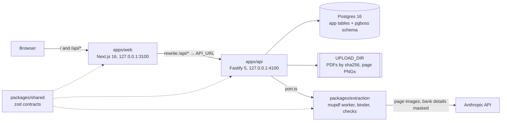

# Architecture

DCT Finance turns signed sponsor contracts into an approved **invoicing master** (the rulebook): every fee, cap, due day and budget-grid cell, each with its page reference. The design rule is **no silent errors**: a value is unconfirmed until the PDF's own text or a person confirms it, and nothing unconfirmed can be approved. The decision behind this is [ADR-001](phase-1/adr-001-extraction-evidence.md).

## Components

| Part | What it does |
|---|---|
| `apps/web` | The only UI. Client components fetch through `src/lib/api.ts` (TanStack Query). In sample mode (`NEXT_PUBLIC_API_MOCK=1`) `src/lib/mock/server.ts` answers every request in the browser instead of the API. |
| `apps/api` | HTTP API under `/api/v1`, probes `/livez` and `/readyz`, and the job workers (pg-boss) in the same process. All state is in Postgres; files are in `UPLOAD_DIR`. |
| `packages/extraction` | Everything that touches a PDF or a model: page count, rendering and text layer (mupdf, in a worker thread), the AI reads, the evidence binder, the contract checks, scoring. The API reaches it only through `apps/api/src/extraction/port.ts`. |
| `packages/shared` | The zod schemas and types every other package uses (rulebook, evidence, review questions, API bodies and DTOs), plus pure helpers that must behave the same on the server and in the browser. |

There is no login. Both servers listen on 127.0.0.1 only. See [security.md](security.md).

## Data flow

1. **Upload** (`POST /uploads`). Each PDF is checked (`%PDF-` magic; mupdf opens it and counts its pages in its worker, within 30 s; at most 100 pages and 50 MB), stored once by sha256, and its text layer is probed: `text` (born-digital, numbers can be checked against it) or `scan`. Row, audit entry and file move commit together.
2. **Create the study** (`POST /studies`). The study row, its document links, the audit entry and an `identify` job commit in one transaction. The same file set sent again while that study is still being set up gives the same study.
3. **Identify** (job). The fast model reads the first 3 pages of each document and suggests each document's kind and the study details (sponsor, protocol, site, investigator). It never overwrites details a person has already confirmed.
4. **Confirm details** (`PATCH /studies/:id`). Locked once any version is approved.
5. **Read** (`POST /studies/:id/extract` → `extract` job). A new version `N` is created as `extracting`. The job:
   - checks the page and image limits before rendering anything;
   - classifies every page (fast model), then reads contract terms and budget grids (primary model) from page images with bank details painted over;
   - stops before any model call once the read's tracked spend reaches `EXTRACTION_MAX_USD` ($20 by default);
   - runs the deterministic contract checks (`runContractChecks`);
   - on an amendment, carries the live version's corrections forward (`carryCorrections` in `apps/api/src/domain.ts`), and each arm's governing grid while that arm's grids are unchanged (`carryGrid`).
6. **Evidence** (no AI, `reviewDraft` in `apps/api/src/review.ts`). The PDF's own text is read (`readTextLayer`), every money value is bound to its spot on the page (`bindEvidence`) and gets a status: `confirmed`, `conflict` or `ungrounded`. On scan pages a grid value can be confirmed only by the contract's own totals, to the cent. Every money term on a text page that the master doesn't hold becomes a question, and so does every scan page, and every text page with a picture big enough to hold prices: a person attests what money terms it holds.
7. **Review, blind** (`POST .../review/:itemId`). The version is now a `draft` with a list of questions (review items): the values not confirmed, money terms the master doesn't hold, contract problems, the **interpretations** (how a clause bills, picked blind), pages, corrections an amendment couldn't carry, and the **blind sample** (10 confirmed values re-typed: shown at their page only, never compared with what the PDF check found; a first answer that differs is typed once more, blind, and that answer is final). A value with an open question is withheld from every response, with what it decides (a cap's limit while its kind is asked, say), so the person types or picks what the page says without seeing the AI's reading. A typed value is compared with the PDF text at that spot, a pick with the reading. If they differ, the person answers again to settle it; a note is required to keep a value other than the one the PDF text prints, or whenever the PDF text prints nothing usable at that spot (the approver sees those answers marked). A settled answer writes the value and marks its evidence `attested`. An answer that changes a number asks what follows from it: a grid's totals checked again on the typed numbers (a settled total whose answer no longer holds is asked again), which grid to bill when an arm's grids now differ, a cap's limit once its kind is known. A money term answered "bill by hand" goes on the master's **bill-by-hand list** (`unclassified`). A sample value kept different from what the PDF check confirmed is a **sample miss**: an incident, alerted to everyone. The full rules are in [api.md](phase-1/api.md#review-questions-adr-001).
8. **"This looks wrong"** (`POST .../report`). Any single value can be reported. On a draft it becomes a blind question. On the live version it opens a **correction draft** (`N+1`, a copy plus the question); the live version stays live until the draft is approved.
9. **Proofread** (optional, `POST .../proofread`). "Looks right" marks per value, on drafts and live versions. They never change a number and approval doesn't need them.
10. **Approve** (`POST .../sign-off`). The API's gate (`signOffRefusal`, see [AGENTS.md](../AGENTS.md#money-invariants)): the version unchanged since the approver opened it (`asOf`), by-hand typing marked done, every question settled, every arm with grids billing one, every evidence entry `confirmed` or `attested`, after a sample miss every value of that kind proofread or typed, and maker-checker (on by default). The approver can send answers back (`POST .../send-back`), which reopens them blind. The web adds two steps the API doesn't enforce: ticking every key term shown (`keyTerms` in `apps/web/src/lib/approve.ts`: payment, holdback, overhead, screen failures, each billed grid's per-patient total, the biggest site fees, the invoice deadline, when an amendment applies; how many depends on the contract) and typing initials.
11. **Live**. The approved version is `signed` and immutable (API check and database trigger). The previous live version becomes `superseded` in the same transaction.
12. **Export** (`GET .../export.xlsx`, and the printable summary page). Approved versions only, named from the approved version's own study details. The bill-by-hand list has its own sheet.
13. **Amendment**. Upload the amendment and read again (`POST /studies/:id/extract` with `documentIds`). The new draft is reviewed like any read, and also asks from what date its terms apply; the old version stays live until the new one is approved.

A contract that can't be read is **typed by hand**: `POST .../versions/by-hand` starts a blank draft, every typed value is `attested`, and `by-hand/done` runs the contract checks on what was typed, asks every value nobody typed or picked (a number the blank form had to fill, a yes/no or fixed-list default, the holdback's scope), and picks up to 10 typed values for someone else to re-type blind. After that, "This looks wrong" corrects a value, as on a read.

## Jobs

pg-boss runs inside the API process, on the same Postgres database (schema `pgboss`). Our `jobs` table is the lasting record (state, progress, plain-words error); its row id is the pg-boss job id.

| Queue | Does | Retries | Time limit |
|---|---|---|---|
| `identify` | Suggest document kinds and study details | 2, 5 s apart | 15 min |
| `extract` | Read a contract, bind evidence, build questions | none: each try pays for AI reads | 2 h |
| `stranded` | Dead letters of the two above: mark our row (and a read's version) failed in plain words | 5 | — |
| `maintenance` | At startup and every 10 min: fail live rows whose pg-boss job ended or is gone, fail versions stuck `extracting` with no job, delete idempotency keys older than 24 h | none | — |

- A job is queued in the same transaction as its row (`queueJob` in `apps/api/src/jobs.ts`), so a row is never left queued with nothing to run it.
- `extract` claims its row (`queued` → `running`) once, so a second delivery does nothing. A partial unique index allows at most one live read per version.
- Workers heartbeat every 30 s. A job that misses 60 s of heartbeats, or runs past its time limit, is failed by pg-boss into `stranded`. What happens when the server dies is in the [runbook](runbook.md#jobs-when-the-server-stops).

## Study stages

The study's `status` is derived from its versions in `refreshStudyStatus` (`apps/api/src/domain.ts`) after every version change, so it can't drift.

| Latest version | No live version | A live version exists |
|---|---|---|
| none | `setting_up` | — |
| `extracting` | `extracting` | `extracting` (an amendment being read) |
| `failed` | `extraction_failed` | `extraction_failed` (an amendment that couldn't be read) |
| `draft` | `needs_review` | `amendment_in_review` |
| `signed` | `live` | `live` |

The contract list groups by `stage`, a generated column (`apps/api/src/db/schema.ts`): 0 needs you · 1 couldn't read · 2 setting up · 3 waiting for approval · 4 reading · 5 live. `needs_review` and `amendment_in_review` are stage 0 while `needs_you > 0` (every question not settled: unanswered, differs or "can't tell", a Review question too), else 3. Stage 3 can still hold approval: a sample miss's proofreading isn't a question, so it isn't counted. A stage change into 0, 1 or 3 raises an alert.

The web shows the same journey as six steps: Upload, Reading, Checking, Needs you, Approve, Live (`apps/web/src/lib/review.ts`).

## Glossary

| Term | Meaning |
|---|---|
| Invoicing master, rulebook | The structured terms of one contract (`Rulebook` in `packages/shared/src/rulebook.ts`): study details, payment terms, overhead, budget grids, invoiceables, site fees, holdback, deadlines and so on. Money is integer cents. "Invoicing master" is the word on screen; "rulebook" is the word in code. |
| Version | One rulebook for a study, numbered from 1. `extracting` → `draft` (or `failed`) → `signed` → `superseded`. Only a draft changes. |
| Evidence | One entry per money value (`ValueEvidence`): `confirmed` (the PDF text at that spot says the same, or a scan's totals agree to the cent), `attested` (a person typed or chose it without seeing the AI's reading), `conflict` (the PDF text says otherwise), `ungrounded` (not found). Only `confirmed` and `attested` can be approved. |
| Review item, question | Something a person must answer before approval (`ReviewItem`): a number to type, a money term the master doesn't hold, a contract problem, an interpretation, a scan or picture page to attest, a sample value. Every one must be settled before approval; a blocker only by a typed value or a pick, a Review one also by a fixed reason with a note. |
| Interpretation | How a clause bills (overhead scope, how visits are paid, a fee's trigger, a cap's kind, the screen-fail terms, the holdback's scope, rounding, an amendment's start date), picked blind from the field's own values next to its quote, nothing preselected (`packages/shared/src/questions.ts`). A pick that differs from the reading shows both and is confirmed with a note. |
| Blind sample | After every AI read, 10 values the PDF check confirmed, drawn at random over grid prices, visit totals, fees and rules, and re-typed blind, each shown at its page only, never next to what the check found. How silent errors are measured in production (ADR-001 §6). |
| Retyped sample | A sample value whose first answer differed from what the PDF check confirmed (`retyped`). It's typed once more, blind, and that answer is final: the confirmed value (a typo), or a miss. "Can't tell", a send-back or a changed answer don't reset it. |
| Sample miss | A sample value kept different from what the PDF check confirmed, after looking again: logged as an incident, alerted to everyone, and approval waits until every value of that kind is proofread or typed. A miss stays a miss. |
| Bill by hand, unclassified | A money term the master has no field for, listed on the master itself (`Rulebook.unclassified`) by answering "bill by hand". Approved with it, shown on the print page and in the Excel "Bill by hand" sheet. |
| Blind entry | While a value has an open question, the server withholds it (null) from every response, search, diff, audit entry and alert, and blanks the numbers in what could restate it (its item's other words, notes about it, a bill-by-hand term quoted from its line). The person types what the page says; then it's compared. |
| Maker-checker | A setting, on by default. Anyone who decided something on a version (its `editors`) can't approve it; names are compared ignoring case and edge spaces. Re-typing a hand-typed value must always be someone else. |
| Amendment | A new read of a study that already has a live version, usually with new documents. The live version stays live until the amendment's version is approved. |
| Correction draft | The draft "This looks wrong" opens on a live version: a copy of it plus a blind question about the reported value. |
| Typed by hand | A version entered by a person because the contract couldn't be read. Every value is `attested`; up to 10 are re-typed blind by someone else. |
| Governing grid | The budget grid billing uses for an arm whose grids conflict, picked per arm by answering that arm's `GRID_CONFLICT` question (`governingGridIds`; read through `governingGrids()`). Grids that price an arm identically bill once with nothing to ask; grids that differ in anything, a single cell too, bill nothing until one is chosen (`billedGrids`), and approval waits. An answer that makes an arm's grids differ asks the question then. One arm's pick never changes another's; an amendment that changes an arm's grids asks again. |
| As printed | For a total that doesn't add up, the answer "the total as printed": it writes back the total the contract prints, kept on the question (`asPrinted`) as the read had it, or as a person last typed it (a correction, a sample, "This looks wrong"). Never the sum. "The sum" writes the parts added up instead. |
| Stranded job | A job pg-boss failed for good (its server died, it ran out of time, its handler threw), copied to the `stranded` queue and marked failed there in plain words. |
| Sample mode | The web with `NEXT_PUBLIC_API_MOCK=1`: an in-browser sample server with invented data, no API or database. |
| Fake mode | The API with `EXTRACTION_FAKE=1`: the AI calls return a synthetic reading. Page images, the text layer and the evidence binding are real. |
